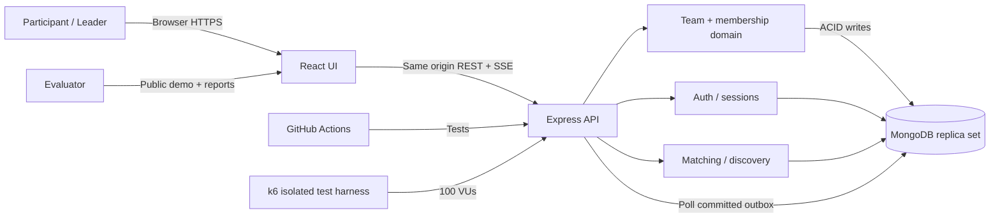

# 02 — Technical Requirements & System Architecture (TRD)

**Read with:** `03-DATABASE-INVARIANTS.md`, `04-API-EVENTS.md`, `07-TEST-PLAN.md`. Critical requirements: O-01…O-13.

## 1. Architecture decision summary

- **Shape:** TypeScript modular monolith, single Express web process; React SPA bundled and served from the same origin in production.
- **Backend:** Express 5, Node.js 24 LTS, Zod validation, native MongoDB driver, Pino, Argon2id, sessions in DB.
- **Frontend:** React 19, Vite, Tailwind CSS 4, shadcn/ui, React Router, TanStack Query, React Hook Form, Zod.
- **Realtime:** HTTPS `text/event-stream` with `EventSource`, durable transactional outbox (MongoDB) + bounded polling in API. Client invalidates/refetches on event/reconnect.
- **Data:** MongoDB replica set, transactions for membership lifecycle, unique indexes as backstop. Atlas for demo; local Docker one-node RS for tests; **never** use standalone Mongo for transaction tests.
- **CI/verification:** Vitest/Supertest; test database, Playwright accessibility/smoke, k6; GitHub Actions.
- **Delivery:** Render free web service + Atlas free cluster. No persistent local files. Environment-specific telemetry.

### Context diagram



**Responsibility boundaries:** Controller parses/authenticates; service validates domain rule and performs transaction; repository executes DB commands; SSE dispatcher publishes committed outbox events. A controller must not independently mutate `teams.memberCount` or `memberships`.

## 2. Directory / module design

```text
apps/api/src/
  app.ts server.ts
  config/ env.ts
  db/ client.ts indexes.ts transaction.ts
  middleware/ session.ts csrf.ts rate-limit.ts validation.ts errors.ts
  modules/
    auth/       auth.routes.ts auth.service.ts auth.repo.ts
    profile/    profile.routes.ts profile.service.ts
    hackathons/ hackathon.routes.ts
    teams/      team.routes.ts team.service.ts team.repo.ts
    membership/ membership.service.ts rules.ts
    requests/   request.routes.ts request.service.ts
    invites/    invite.routes.ts invite.service.ts
    matching/   matching.routes.ts scoring.ts
    discovery/  discovery.routes.ts discovery.service.ts
    audit/      audit.service.ts
  realtime/ outbox.repo.ts dispatcher.ts sse.ts
  observability/ logger.ts metrics.ts
packages/contracts/src/  schemas/ errors.ts events.ts index.ts
apps/web/src/          routes/ components/ features/ api/ hooks/ styles/
```

**Dependency direction:** HTTP routes → domain services → repositories. Shared contracts contain pure validation/types. Repositories do not import HTTP or UI modules. Services are thin enough to explain at interview.

## 3. Domain invariants (never optional)

- **I-01** Unique active membership per `(hackathonId,userId)` enforced by unique DB index. Leaving removes the active membership document and retains an audit event.
- **I-02** Every active team has `1 <= memberCount <= maxSize`, and the integer equals count of active membership documents.
- **I-03** Every active team has exactly one leader; `leaderId` references a current member.
- **I-04** `minSize` ≤ `maxSize`, both within hackathon bounds; readiness derived by count, not independently editable.
- **I-05** No mutation of membership, team count/leader, invite use, request resolution, audit/outbox without an atomic transaction.
- **I-06** An idempotency key's successful result is recorded atomically with its side effects; same key/different fingerprint conflicts.
- **I-07** No private event leaks to unprivileged stream subscribers.
- **I-08** An expired/revoked/consumed invite never authorizes a join even if a TTL record remains.
- **I-09** A pending join request does not hold a seat; approval rechecks conditions at the commit point.
- **I-10** Deleted teams are hidden from active board; last member leave stores deletion audit and no active membership remains.

## 4. Transaction and concurrency strategy

### A. Creating a team

Transaction: check hackathon active → validate input and policy → verify requester not in another team → insert team document with `memberCount:1, leaderId:actorId` → insert membership with unique compound index → insert `team.created` audit and public outbox event → insert idempotency result → commit. A different concurrent team creation for the same user hits membership uniqueness; transaction aborts, no ghost team.

### B. Admitting a member

All paths (approved request and invitation redemption) call **one** `admitMemberInTransaction({session,actorId,teamId,applicantId,source})` helper. Preconditions are checked again *inside* the transaction; the atomic reservation is:

```ts
const seat = await teams.updateOne(
  { _id: teamId, deletedAt: null,
    $expr: { $lt: ['$memberCount', '$maxSize'] } },
  { $inc: { memberCount: 1, version: 1 },
    $set: { updatedAt: new Date() } },
  { session }
);
if (seat.modifiedCount !== 1) throw new TeamFullError();
await memberships.insertOne({ hackathonId, teamId, userId: applicantId, joinedAt: new Date() }, { session });
// Then update request / redeem invite, append audit+outbox, idempotency result.
```

This is *illustrative*, not production-ready copy/paste: hackathon ID, source validation, leader authority, request state, invite secret hash, retries, timeout, error mapping and duplicate handling are required in surrounding code.

Transactions that conflict on the same team document cause retries / re-evaluation. When capacity is exhausted, all eventual losers return `TEAM_FULL`, not 500. Unique membership constraint prevents a user from joining two different teams at the same time. MongoDB driver `withTransaction` handles labeled transient retries; cap overall request time and return a retryable failure if DB remains unavailable. Never run parallel Mongo commands on a single transaction session.

### C. Simultaneous approve / invite / leave / resize

- Leader approval verifies *current* leadership inside transaction. Approval of two requests for one seat contends on team version/count; one wins.
- Invite redemption updates same team doc and atomically changes `invite.usedAt/usedBy` from null to actual actor; both must commit together.
- Leader leave and approval both write team, serializing their outcomes. A former leader loses permission if no longer current leader when operation retries.
- Lowering max size is allowed only when `newMaxSize >= current memberCount`; guarded update changes version. Concurrent joins conflict and re-evaluate.
- Team last-member leave writes `deletedAt` in the same transaction as membership removal and audit. No later join may commit against deleted team.

### D. Idempotency / ambiguous commits

1. Client generates UUID request key **once per logical user action**; retries reuse it. `POST/PATCH/DELETE` mutation routes require key for domain side effects.
2. Server computes canonical request hash over validated payload, actor, action and resource scope.
3. Lookup `{actorId,scope,key}` first; completed matching record -> replay status/body with `Idempotency-Replayed:true`; mismatch -> 409.
4. New record, mutation and exact success outcome are committed together in MongoDB. Unique index on scoped key arbitrates duplicate requests.
5. Concurrent duplicate keys may collide; the loser waits briefly/re-reads the committed result with bounded retries. It must **not** commit a second side effect.
6. If commit response is unknown, first query scoped idempotency record by key rather than retrying a blind new mutation. Driver's commit-retry logic remains enabled.
7. Rejected business-rule requests are not necessarily cached; document stable response where same submitted action remains invalid. Prevent duplicate effects, not impossible immutability of all errors.

Idempotency data has a 24h TTL and a retention notice. The app does not promise deduplication after that period.

### E. Leadership succession

When a member leaves, load current team and its membership sorted by `(joinedAt, _id)`. If leader leaving and there are others, choose oldest remaining; write `leaderId`, decrement count, delete departing membership, append audit inside transaction. An explicit leader transfer only chooses a current member. If last member leaves, set `deletedAt`, decrement to zero, delete membership, record `team.deleted` and `member.left` events. Queries filter `deletedAt:null`.

### F. No side effects inside retryable transaction callbacks

Do not send SSE, send messages, write files, or call external APIs inside `withTransaction` callback; it may execute more than once. Only DB writes are permitted there. Durable `realtime_events` outbox is inserted transactionally; dispatcher publishes **after commit**. Consumers treat duplicate outbox deliveries as harmless invalidate/refetch signals.

## 5. Real-time design

- `GET /api/v1/hackathons/{id}/events` returns `text/event-stream`, authenticated, keep-alive heartbeats (e.g. 20s), stable `eventId`, small event envelopes, and retry hints.
- Outbox stores `scope` (`public-hackathon`, `team`, `user`), `hackathonId`, optional `teamId/userId`, type, minimal payload, committed timestamp. Dispatcher polls ~500–1000ms and fanouts only to authorized active subscribers. Aim for <2s freshness in active single-instance demo; measure rather than guarantee.
- On `EventSource` `open`/reconnect, invalidate relevant TanStack Query keys, refetch authoritative state, and handle deduplicated events (`id`). Last-Event-ID replay can be P1; initial safe fallback is full refetch. Never include emails, invite secrets, tokens, or internal audit detail in public board events.
- If dispatcher crashes after transaction commit but before delivery, persisted outbox permits catch-up after restart. If client was disconnected, refetch restores state.
- A single Render free instance is supported. Multi-instance needs shared pub/sub or global outbox-leasing and fanout architecture; document as scalability limitation.

## 6. Matching and discovery

- Eligible candidate = user with opt-in discoverable profile, complete skills/timezone, and **no active membership** in requested hackathon.
- Team missing skills = `requiredSkills - union(member.skills)`. Let C be percentage of missing skills candidate covers ×100. If no missing skills, C = percent of *candidate skills* novel to team (0 if candidate has none).
- Time compatibility T = min(100, `overlapHours / 4 * 100`) where overlap hours is candidate/team declared preferred working-hour intersection normalized across zones; validate correct date and DST using IANA timezone on a reference day/week. No availability declared -> T=0 with explanation.
- Score = round(0.7*C + 0.3*T). Stable order by score descending then userId ascending; omit users already in target team. Return component score and human-readable reasons.
- Optional availability by week, not a mutable AI oracle. This is a proposed score, not organizer-specified weights.
- Board query uses indexed event/status/updatedAt and cursor paging; search with prefix/tag filters, never uncontrolled regex scans or huge skip offsets. For 2k teams, validate actual explain plans.

## 7. Security and infrastructure

See `06-SECURITY.md`. All state-changing routes require session, CSRF defense and permission check. Only leader approves/declines/removes. Invites are `crypto.randomBytes(32).toString('base64url')`, stored as SHA-256 digests, checked by expiry and unused flag. Share invite through `/invite#token=...` fragment (not an HTTP path/query) and strip it on the client immediately. Hashing does not replace entropy or rate limiting.

Render front+API single origin; Atlas remote persistence. Local Docker RS for tests. Set NODE_ENV, PORT, MONGODB_URI, SESSION_COOKIE settings, APP_ORIGIN and rate limiting. No email or third-party LLM keys required.

## 8. Observability / performance

- Structured Pino request log with requestId, route template, status, duration and userId when safe; redact cookies, passwords, raw invite token.
- Metrics: count success/conflicts/5xx for membership and duplicate requests, transaction retry count, SSE connections, board durations. In-memory counters are demo-level only.
- Board endpoint performance target: p95 <200ms at 100 simultaneous k6 VUs against a representative seed. Record warmup, duration, percentile distribution, error rate, host, DB tier, deployment type, network, and latency inclusion/exclusion (cold starts).
- Atlas free 100 operations/sec and Render spin-down can affect throughput/latency; never infer hosted SLA from local benchmark.

## 9. Non-functional requirements / bounds

- API request max body ~64KB; strict Zod validation and content-type checks; request IDs on every response.
- Paginated lists max 50 records/page; field projections exclude secrets; `no-store` on auth/private endpoints.
- `SSE` reconnect and heartbeat, lifecycle cleanup on browser close and server shutdown.
- UTC data storage (ISO8601 response); UI local timezone conversion with valid IANA zone.
- Frontend widths 320–1440; keyboard access for every critical action, no hover-only controls.
- Server graceful shutdown closes HTTP listener/SSE clients, drains in-flight operations up to bounded timeout; DB transaction termination/rollback handled by driver.
- Reproducible database seed and CI tests, no real user email used as seed.

## 10. ADRs — Architecture Decision Records

**ADR-001 MongoDB over PostgreSQL (accepted):** aligns with organizer stack; unique compound indexes and transactions support invariants. Downside: more careful multi-document transaction handling and local replica-set setup. Alternative PostgreSQL would simplify some constraint/lock workflows, but loses stack alignment. Revisit only with proven technical blocker.

**ADR-002 Native driver over Mongoose (accepted):** exposes session boundaries and conditional updates; costs type/validation boilerplate. Zod + typed repositories offset that cost.

**ADR-003 SSE over WebSockets (accepted):** event delivery server→browser only, HTTP mutations client→server; simpler reconnection. Does not cover bidirectional chat and requires shared delivery infrastructure when horizontally scaled.

**ADR-004 Modular monolith over services (accepted):** easier atomic DB transaction, one deployment and test harness. Scaling and independent release are limited but irrelevant to deadline.

**ADR-005 Deterministic scoring over LLM matching (accepted):** auditability, cost, repeatability; less semantically sophisticated than embeddings, but requirement only asks complementary skills and timezone and score explanation.

**ADR-006 Durable transactional outbox (accepted, minimal implementation):** prevents process crash between successful commit and notification from permanently losing event intent. Adds collection/poller; if time-critical, do not remove without documenting reliability limitation.

**ADR-007 No public test-only join endpoint (accepted):** race harness uses authorized production operations and fixtures. Prevents accidental bypass of domain permissions.

## 11. Diagrams

Editable files: `../diagrams/01-context.mmd`, `02-admission-sequence.mmd`, `03-membership-state.mmd`, `04-sse-flow.mmd`. Each serves one distinct purpose; do not add decorative diagrams.

## 12. Reference reading

- https://www.mongodb.com/docs/drivers/node/v6.x/crud/transactions/
- https://www.mongodb.com/docs/manual/core/index-unique/create-compound/
- https://www.mongodb.com/docs/manual/core/index-partial/
- https://expressjs.com/en/5x/guide/error-handling/
- https://developer.mozilla.org/en-US/docs/Web/API/EventSource
- https://grafana.com/docs/k6/latest/using-k6/thresholds/
