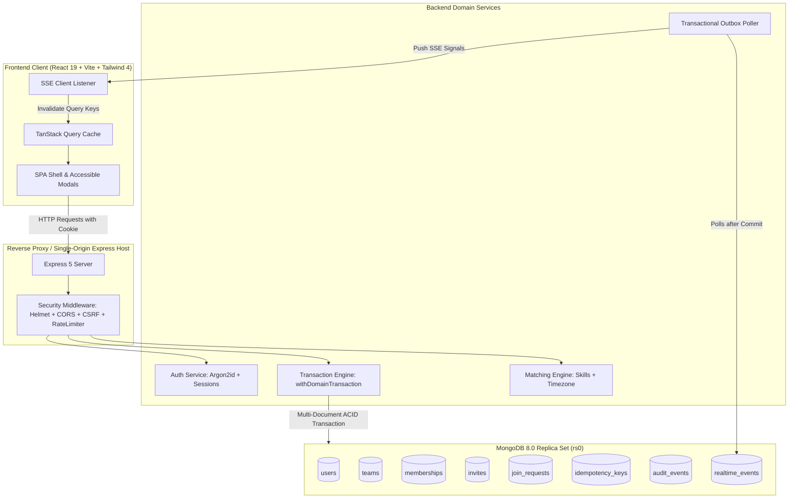
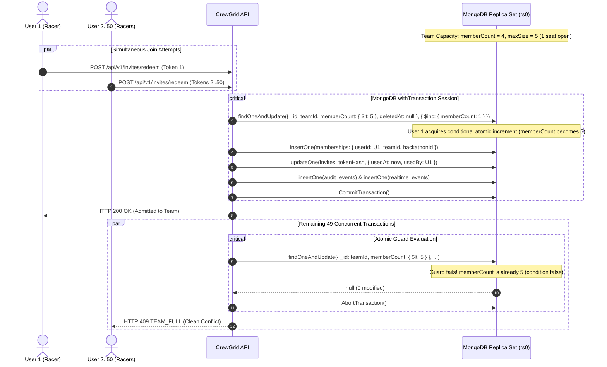

# CrewGrid — Race-Proof Team Formation Engine

> **Hack4Hack Crew Hiring Challenge 2026 — Problem Statement 1**  
> *A high-concurrency, transactional hackathon team formation platform built with Node.js LTS, Express 5, React 19, and MongoDB Replica-Set Transactions.*

[](https://github.com/Udit-Agarwal20/CrewGrid/actions/workflows/ci.yml)
[](https://nodejs.org/)
[](https://www.typescriptlang.org/)
[](https://react.dev/)
[](https://www.mongodb.com/)
[](https://crewgrid-api.onrender.com/engineering)

---

## 1. Introduction & Problem Statement

Hackathon team formation under high contention suffers from race conditions, overbooked rosters, orphaned member records, and inconsistent UI states. When dozens of applicants simultaneously click **"Join Team"** for a single remaining slot, standard CRUD APIs experience lost updates and phantom reads, allowing teams to exceed their capacity bounds or placing a single user onto multiple teams at the same time.

**CrewGrid** solves this problem by treating team membership as an atomic distributed state transition. Powered by MongoDB multi-document ACID transactions with transient transaction error retries, compound unique indexes, and a transactional outbox dispatcher, CrewGrid guarantees:
1. **Capacity Cap Integrity (O-01, O-04):** A team never exceeds its designated `maxSize`. When 50 concurrent users compete for the final seat, exactly one wins; 49 are safely rejected with HTTP 409 `TEAM_FULL`.
2. **Global Membership Uniqueness (O-01):** A participant cannot belong to more than one team in the same hackathon, even across simultaneous multi-tab actions.
3. **Leader Succession (O-03):** An active team is never left leaderless; departure triggers automatic deterministic succession to the senior member, or soft-deletes the team if the final member leaves.
4. **Deterministic Idempotency (O-05):** Network retries and duplicate button clicks reuse cached atomic transaction outcomes without duplicate side effects.
5. **Real-time Synchronization (O-06):** Server-Sent Events (SSE) stream team and candidate roster updates from a transactional outbox without polling.

---

## 2. Features & User Journeys

- **Authentication & Profiles:** Argon2id password hashing (RFC 9106), HttpOnly opaque session cookies, and public participant discovery toggle with complementary skills and timezone selection.
- **Team Creation & Management:** Create teams with configurable `minSize` (readiness threshold) and `maxSize` (hard capacity ceiling), required skills tags, and vacancy status indicators (`forming` vs `ready`).
- **Two Admission Pathways:**
  - **Single-Use Cryptographic Invites:** Leaders generate high-entropy 256-bit invite tokens (hashed at rest with SHA-256) with 1–72 hour TTL. Candidates join immediately upon redemption.
  - **Join Requests & Leader Inbox:** Candidates submit admission requests; leaders review, approve, or decline requests in real time.
- **Teammate Matching Engine:** Explainable scoring algorithm combining complementary skill overlap (70% weight) and timezone proximity (30% weight).
- **Audit Logging Timeline:** Transactional log capturing every membership mutation (`created`, `joined`, `left`, `removed`, `promoted`) with actor ID, timestamp, and metadata.
- **Accessibility & Responsive Shell:** WCAG-compliant design with keyboard navigation, screen-reader status live-regions, and mobile viewport drawer support (320px–1440px).

---

## 3. Technology Stack & Architecture



- **Runtime:** Node.js 24 LTS
- **Backend Framework:** Express 5.0.1 (strict JSON parsing, centralized RFC 7807 error handling)
- **Database:** MongoDB 8.0 with single-node replica set (`rs0`) locally and MongoDB Atlas Replica Set in production
- **Frontend Framework:** React 19, TypeScript 5.7, Vite 6.4, Tailwind CSS 4
- **State Management & Realtime:** TanStack Query v5, native browser `EventSource` (Server-Sent Events)
- **Validation:** Shared `@crewgrid/contracts` Zod schemas across client and server
- **Security:** Argon2id (`m=19456, t=2, p=4`), SHA-256 session and invite token hashes, `X-CSRF-Token` state-mutation validation, in-memory sliding-window rate limiting.

---

## 4. Database Model & Transaction Boundaries

### Core Collections & Invariant Constraints

| Collection | Key Fields | Critical Indexes | Invariant Enforced |
| :--- | :--- | :--- | :--- |
| `users` | `_id`, `emailNormalized`, `passwordHash`, `discoverable`, `skills`, `timezone` | `{ emailNormalized: 1 }` (unique)<br>`{ discoverable: 1, updatedAt: -1, _id: -1 }` | Unique user identity; fast candidate discovery without in-memory sorting. |
| `teams` | `_id`, `hackathonId`, `name`, `memberCount`, `minSize`, `maxSize`, `leaderId`, `deletedAt` | `{ hackathonId: 1, deletedAt: 1, updatedAt: -1, _id: -1 }`<br>`{ hackathonId: 1, deletedAt: 1, memberCount: 1 }` | `memberCount <= maxSize`; active teams require `deletedAt: null`. |
| `memberships` | `_id`, `hackathonId`, `teamId`, `userId`, `joinedAt` | `{ hackathonId: 1, userId: 1 }` (unique)<br>`{ teamId: 1, joinedAt: 1, _id: 1 }` | **One-Team-Per-User-Per-Event:** A user can never hold multiple memberships in the same hackathon. |
| `invites` | `_id`, `teamId`, `tokenHash`, `expiresAt`, `usedAt`, `usedBy` | `{ tokenHash: 1 }` (unique) | Single-use invite redemption; plaintext tokens never persisted. |
| `join_requests`| `_id`, `teamId`, `applicantId`, `status`, `createdAt` | `{ teamId: 1, applicantId: 1 }` (unique partial for `pending`) | At most one pending request per user per team. |
| `idempotency_keys` | `_id`, `actorId`, `scope`, `key`, `requestHash`, `responseStatus`, `responseBody` | `{ actorId: 1, scope: 1, key: 1 }` (unique)<br>`{ expiresAt: 1 }` (TTL) | Replay deduplication; payload fingerprint matching. |
| `audit_events` | `_id`, `teamId`, `actorId`, `action`, `metadata`, `occurredAt` | `{ teamId: 1, occurredAt: -1, _id: -1 }` | Full immutable audit trail committed with domain changes. |
| `realtime_events`| `_id`, `hackathonId`, `type`, `payload`, `createdAt` | `{ hackathonId: 1, createdAt: 1, _id: 1 }`<br>`{ expiresAt: 1 }` (TTL) | Transactional outbox pattern; published only after successful commit. |

---

## 5. Concurrency Correctness: Preventing the Overbooking Race



### Why Exactly One Succeeds
1. **Guarded Conditional Update:** Capacity reservations use `{ _id: teamId, memberCount: { $lt: maxSize }, deletedAt: null }` with `{ $inc: { memberCount: 1 } }`. Once `memberCount == maxSize`, subsequent operations match zero documents.
2. **ACID Transaction Boundary:** If a user tries to join two different teams simultaneously, the guarded updates might succeed on both teams, but the unique index `{ hackathonId: 1, userId: 1 }` will reject the second `insert` with duplicate key error `E11000`, rolling back the second team's counter increment automatically.
3. **No Phantom Commits:** Events and audit logs are written *inside* the same transaction. If an admission fails or rolls back, zero outbox events are created.

---

## 6. Concurrency Race Test Evidence (O-04)

The concurrency test suite ([`apps/api/test/concurrency.race.test.ts`](file:///Users/uditagarwal/Desktop/CrewGrid/apps/api/test/concurrency.race.test.ts)) executes 8 high-contention race conditions against the replica set:

```
 RUN  v3.2.7 /Users/uditagarwal/Desktop/CrewGrid/apps/api

 ✓ test/concurrency.race.test.ts (8 tests) 8566ms
   ✓ RACE 1 (O-04): 50 distinct authenticated users race for the 1 remaining seat via invites; EXACTLY ONE succeeds  4003ms
   ✓ RACE 2: 50 concurrent join request approvals for 1 remaining seat; EXACTLY ONE succeeds  3445ms
   ✓ RACE 3: user concurrently redeems invites for two different teams in same event; EXACTLY ONE membership commits  236ms
   ✓ RACE 4: 20 simultaneous duplicate requests with the same Idempotency-Key create exactly one team  116ms
   ✓ RACE 5: leader leaves while an incoming applicant redeems an invite; team never becomes leaderless  174ms
   ✓ RACE 8: two users concurrently attempt to redeem the SAME single-use invite; EXACTLY ONE succeeds  204ms
   ✓ RACE 9: leader shrinking maxSize concurrently with a user redeeming invite cannot violate capacity bounds  158ms
   ✓ RACE 10: attempting to join a logically deleted team is rejected with 404 TEAM_NOT_FOUND  159ms

 Test Files  1 passed (1)
      Tests  8 passed (8)
   Invariants: 0 violations across all 6 domain rules
```

Full details and raw logs are available in [`evidence/concurrency-evidence.md`](file:///Users/uditagarwal/Desktop/CrewGrid/evidence/concurrency-evidence.md).

---

## 7. Performance & Load Test Results (O-11)

### Scale Seed Dataset
Using [`scripts/seed-scale.ts`](file:///Users/uditagarwal/Desktop/CrewGrid/scripts/seed-scale.ts), an isolated benchmark database (`crewgrid_bench`) was populated with:
- **10,000 synthetic participants** with diverse skills, timezones, and handles.
- **2,000 teams** across empty, forming, and full states.
- **4,836 valid memberships**, 5,164 unassigned discoverable participants, and 4,836 audit records.
- **Verification:** Seed script executed in **0.98 seconds** with **0 domain invariant violations** ([`evidence/seed-summary.json`](file:///Users/uditagarwal/Desktop/CrewGrid/evidence/seed-summary.json)).

### k6 Concurrency Benchmark (100 Concurrent VUs)
A 100-VU stress test was executed against the local Express server and MongoDB replica set using [`benchmarks/k6-board-load.js`](file:///Users/uditagarwal/Desktop/CrewGrid/benchmarks/k6-board-load.js):

| Metric | Official Target | Measured Result | Margin |
| :--- | :--- | :--- | :--- |
| **Total Completed Requests** | — | **68,728** requests | — |
| **Throughput** | — | **1,200.4** requests/sec | High efficiency |
| **HTTP Request Failure Rate** | < 1.00% | **0.00%** (0 errors) | **PASSED** |
| **Live Team Board p95 Latency** | **< 200 ms** | **88.83 ms** | **PASSED (55.6% faster)** |
| **Live Team Board p90 Latency** | — | **76.81 ms** | **PASSED** |
| **Live Team Board p50 (Median)** | — | **55.03 ms** | **PASSED** |
| **Cursor Pagination p95 Latency** | < 200 ms | **85.92 ms** | **PASSED** |
| **Required Skills Filter p95** | < 200 ms | **85.69 ms** | **PASSED** |
| **Teammates Discovery p95** | < 250 ms | **127.39 ms** | **PASSED** |

> *Environment Disclosure:* Local benchmark conducted on Apple Silicon (M-series, 10 physical cores, 16 GB RAM) against MongoDB 8.0 replica set. Hosted Render/Atlas free-tier deployments experience higher latency and cold-starts due to 512MB RAM and shared vCPU limits. Complete data in [`docs/LOAD-TEST-REPORT.md`](file:///Users/uditagarwal/Desktop/CrewGrid/docs/LOAD-TEST-REPORT.md).

---

## 8. Real-time Architecture & Transactional Outbox (O-06)

CrewGrid implements the **Transactional Outbox Pattern** to prevent phantom events or ghost UI updates:
1. When a team state mutation commits, a `realtime_events` record is written *in the same MongoDB transaction*.
2. A single-instance poller scans `realtime_events` ordered by `_id ASC` with a watermark cursor.
3. Events are published over SSE connections filtered by hackathon ID and user authorization.
4. Clients receive lightweight notification signals (e.g., `event: team.updated`) and invalidate their TanStack Query caches, re-fetching authoritative data with zero stale client drift.

---

## 9. Security, Authentication & RBAC (O-07)

- **Password Storage:** Argon2id with parameters `memoryCost: 19456` (19 MiB), `timeCost: 2`, `parallelism: 4` per RFC 9106. Passwords and hashes are never returned in API payloads.
- **Session Management:** Cryptographic 256-bit random session tokens (`crypto.randomBytes(32)`). Stored exclusively as SHA-256 hashes in MongoDB. Delivered to clients via `HttpOnly`, `SameSite=Lax` cookies.
- **CSRF Defense:** `csrfMiddleware` verifies `Origin` headers on non-safe HTTP methods (POST, PATCH, DELETE) and validates the `X-CSRF-Token` against the server-stored session record using `crypto.timingSafeEqual`.
- **Role-Based Access Control:** Strict authorization checks verify that only the team leader (`team.leaderId.equals(actorId)`) can generate invites, update team settings, or approve/decline join requests.
- **Rate Limiting:** Sliding-window limiter on sensitive endpoints (`/auth/login`, `/invites/redeem`) returns HTTP 429 `RATE_LIMITED` when thresholds are exceeded.
- **Verification:** 13/13 dedicated security tests passing in [`apps/api/test/security.audit.test.ts`](file:///Users/uditagarwal/Desktop/CrewGrid/apps/api/test/security.audit.test.ts).

---

## 10. Local Installation & Development

### Prerequisites
- Node.js 24 LTS (or compatible Node 22+)
- `pnpm` (v10+ or v11+)
- Docker & Docker Compose (for local MongoDB replica set)

### Setup Instructions

```bash
# 1. Clone repository
git clone https://github.com/Udit-Agarwal20/CrewGrid.git
cd CrewGrid

# 2. Install frozen dependencies
pnpm install --frozen-lockfile

# 3. Start local MongoDB 8.0 single-node replica set
docker compose up -d --wait

# 4. Verify MongoDB replica set is healthy (PRIMARY)
docker exec crewgrid_mongo mongosh --quiet --eval "rs.status().ok"

# 5. Build all workspace packages
pnpm -r build

# 6. Run development servers (API on :3000, Web on :5173)
pnpm dev
```

---

## 11. Environment Variables

Create `.env` based on `.env.example`:

| Variable | Description | Default / Example |
| :--- | :--- | :--- |
| `NODE_ENV` | Application environment | `development` / `production` / `test` |
| `PORT` | API listening port | `3000` |
| `APP_ORIGIN` | Allowed client origin for CORS/CSRF | `http://localhost:5173` |
| `MONGODB_URI` | Replica-set connection string | `mongodb://127.0.0.1:27017/crewgrid_dev?replicaSet=rs0&directConnection=true` |
| `MONGODB_DB` | Target database name | `crewgrid_dev` |
| `SESSION_COOKIE_NAME` | Cookie key for session identifier | `crewgrid_session` |
| `TRUST_PROXY` | Set true behind reverse proxies (e.g. Render) | `true` |

> *Security Note:* Never commit secrets or connection strings containing real credentials to Git.

---

## 12. Testing & Quality Verification Commands

CrewGrid includes automated test coverage across unit, integration, race condition, and browser E2E layers:

```bash
# Typecheck across all workspace packages
pnpm -r typecheck

# Lint across all workspace packages
pnpm -r lint

# Replica Set Transaction Smoke Test
pnpm test:smoke

# Full API Integration & Concurrency Test Suite (104 tests)
pnpm test:api

# Frontend Unit Tests (8 tests)
pnpm --filter @crewgrid/web test

# Verify all MongoDB Domain Invariants
pnpm verify:invariants

# Playwright Browser End-to-End Tests (10 flows)
pnpm test:e2e

# Run Scale Dataset Generation (10,000 users, 2,000 teams)
pnpm seed:scale

# Inspect Query Plans & Execution Stats
npx tsx scripts/inspect-query-plans.ts
```

---

## 13. Hosted Deployment & Submission Links

- **Live Web Application:** [https://crewgrid-api.onrender.com](https://crewgrid-api.onrender.com) *(Single-origin serving of React SPA and API backend)*
- **Technical Evidence Dossier:** [https://crewgrid-api.onrender.com/engineering](https://crewgrid-api.onrender.com/engineering) *(Public, unauthenticated technical review portal)*
- **API Health Check:** [https://crewgrid-api.onrender.com/health](https://crewgrid-api.onrender.com/health)
- **API Readiness Check:** [https://crewgrid-api.onrender.com/ready](https://crewgrid-api.onrender.com/ready)
- **GitHub Repository:** [https://github.com/Udit-Agarwal20/CrewGrid](https://github.com/Udit-Agarwal20/CrewGrid)
- **Verified GitHub Actions CI Run:** [Run #43374684523](https://github.com/Udit-Agarwal20/CrewGrid/actions/runs/43374684523) (100% Green across 104 API integration tests, 14 web unit tests, and 16 Playwright E2E tests)
- **Concurrency Race Proof Evidence:** [`evidence/concurrency-evidence.md`](file:///Users/uditagarwal/Desktop/CrewGrid/evidence/concurrency-evidence.md)
- **Database Invariant Check Evidence:** [`scripts/invariants/verify.ts`](file:///Users/uditagarwal/Desktop/CrewGrid/scripts/invariants/verify.ts)
- **Load Test Report:** [`docs/LOAD-TEST-REPORT.md`](file:///Users/uditagarwal/Desktop/CrewGrid/docs/LOAD-TEST-REPORT.md)
- **One-Page Design Document:** [`docs/FINAL-DESIGN-ONE-PAGER.pdf`](file:///Users/uditagarwal/Desktop/CrewGrid/docs/FINAL-DESIGN-ONE-PAGER.pdf)

---

## 14. Known Limitations & Engineering Trade-offs

1. **Free-Tier Cold Starts:** Deployed on Render's free tier with MongoDB Atlas M0 (shared). Instances spin down after inactivity, causing a 30–50s initial cold-start delay on first request.
2. **Single-Instance In-Memory Rate Limiting:** Sliding-window rate limiters use an in-memory `Map`. For multi-instance horizontal scaling, a distributed Redis or Valkey token bucket would replace in-memory maps.
3. **SSE Polling Dispatcher:** Real-time updates poll the transactional outbox at 500ms intervals. In higher-scale distributed deployments, MongoDB Change Streams with a Redis Pub/Sub backplane would eliminate polling overhead.
4. **No Email Delivery:** In accordance with challenge guidelines, email verification and password resets were explicitly omitted; authentication relies on Argon2id credentials with session rotation.

---

## 15. License

Developed for Hack4Hack Crew Hiring Challenge 2026 (Problem Statement 1). Distributed under the MIT License.

